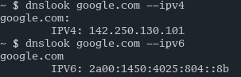

# dnslook
my own nslookup alternative written in C.



# Installation
```bash
git clone https://github.com/cyxap1255/dnslook
```
```bash
cd dnslook
```
```bash
make && sudo make install
```

# Uninstallation
```bash
cd dnslook
sudo make uninstall
rm dnslook
```
